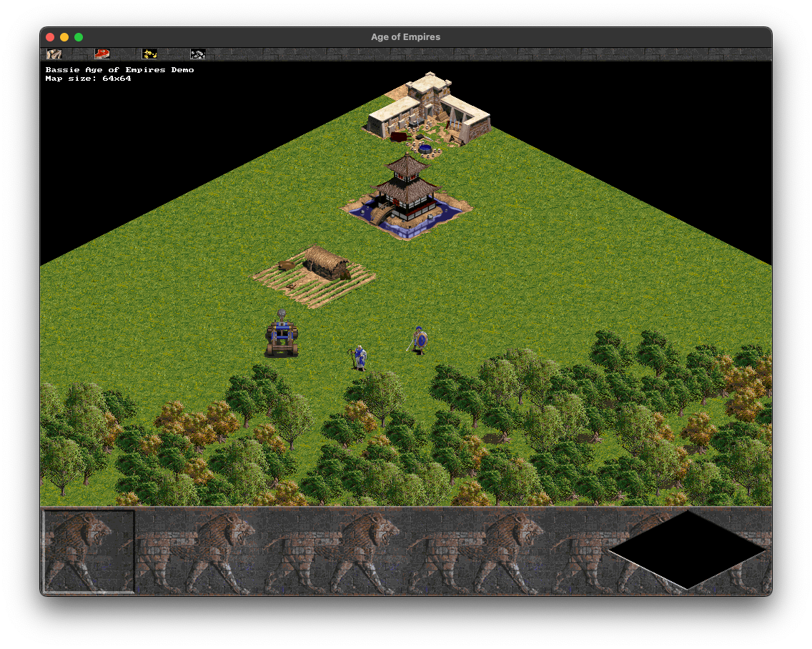
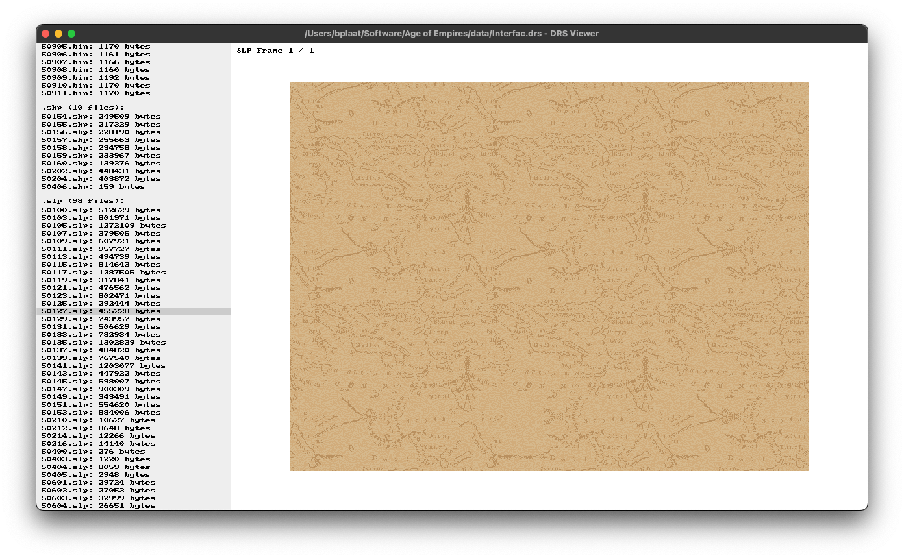

# Empires

An Age of Empires I rendering demo and DRS game-data archive viewer, written in C11 with SDL2. Imported from [bplaat/opengenie](https://github.com/bplaat/opengenie). The demo renders a scene; gameplay is not implemented.

## Building

Install a C compiler, Make, pkg-config, and SDL2:

```sh
# macOS
brew install pkg-config sdl2

# Debian / Ubuntu
sudo apt install build-essential pkg-config libsdl2-dev
```

From the repository root, build both programs with:

```sh
make -C games/empires
```

The executables are written to `games/empires/target/`. `cargo xtask check-others` builds them in Linux CI without requiring game data or opening a window.

## Running

Use data from your own Age of Empires I installation, with its `data/` directory intact:

```sh
games/empires/target/empires "/path/to/Age of Empires"
games/empires/target/drsviewer "/path/to/Age of Empires" graphics.drs
```

The viewer opens `Interfac.drs` by default; that archive also supplies its palette when another archive is selected. Archive filenames must match the files on disk, including case on case-sensitive filesystems. Game data is not included.

## Screenshots


_A screenshot of the Age of Empires demo (nothing is working just some rendering so far!)_


_A screenshot of a little tool to inspect DRS files which contain all the game data_

## License

Copyright © 2019-2026 [Bastiaan van der Plaat](https://github.com/bplaat)

Licensed under the [MIT](../../LICENSE) license.
