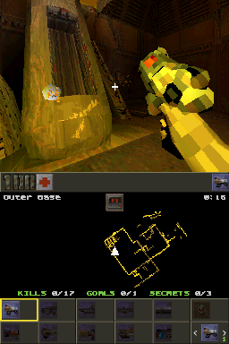

# Quake II for Nintendo DS

A port of id Software's [GPL Quake II source](https://github.com/id-Software/Quake-2)
to the Nintendo DS and DSi, rendered by the DS 3D hardware.

Quake II doesn't fit in the 4 MiB of a DS: on a DS it needs the 8 MiB
Memory Expansion Pak of the DS Browser in the GBA slot. A DSi or 3DS has the
16 MiB it needs and no GBA slot. Without either it stops with a message.

The whole game plays with sound. It is still a work in progress: it hasn't
run on a DSi or on hardware yet, see [To do](#to-do).

## Controls

| Button | In game       | In menus     |
| ------ | ------------- | ------------ |
| D-pad  | Move and turn | Navigate     |
| A      | Fire          | Select / yes |
| B      | Jump          | Back / no    |
| X      | Next weapon   | Backspace    |
| Y      | Run (hold)    |              |
| L / R  | Strafe        | Page up/down |
| SELECT | Help computer | Help         |
| START  | Menu          | Close menu   |
| Stylus | Weapon, item  |              |

The top screen shows the 3D view with the crosshair, the messages and
center prints over it, and the menus, the loading plaque and, at 1:1, the
help computer and the inventory. The touch screen shows Quake II's status
bar at the top, the map in the middle, following you, with the level name,
time, kills, goals and secrets, and at the bottom a cell for each weapon
with its icon and ammo, dark until you have it, the one in your hands in a
yellow frame, and one for the selected item. Tap a weapon to use it, the
item to use that or its arrows to select another one. A picked up item and
the timer of a powerup show over the top of the map. With the menu and
while no game runs it shows the controls, and the console when it is down.

There is no looking up and down: like in DOOM, firing aims at a monster in
sight above or below you. The menus have Game, Options and Quit,
there is no multiplayer. Options has the effects volume, brightness, always
run, the crosshair and resetting the defaults.

Closing the lid puts the console to sleep. L+R+START+SELECT, or the DSi power
button, quits.

## Building

```sh
./build.sh                  # fetch, patch and build target/quake2.nds
./build.sh dev              # fetch and patch, then edit and commit in target/Quake-2-*/
./build.sh export-patches   # write those commits back to patches/
./build.sh clean            # remove target/
```

DeSmuME emulates the Memory Expansion Pak, the [runner](../../../tools/nds-toolchain) puts
one in the GBA slot with its `pak` command:

```sh
../../../target/nds-toolchain/bin/desmume-runner target/quake2.nds pak 'wait 2000' 'shot quake2.png'
```

## Game data

`assets/` is Quake II's base directory: game data goes in `assets/baseq2/`.

| File              | Game                                            |
| ----------------- | ----------------------------------------------- |
| `baseq2/pak0.pak` | Quake II demo 3.14 (the first unit), by default |

The freely distributable Quake II demo is downloaded from Yamagi's mirror of
id Software's files, checksum verified and embedded in the ROM through
NitroFS with its `license.txt`, which has to go with it, so the `.nds` is
always playable, even without an SD card. The demo's license only allows
distributing it free of charge, together with that license. Game data on
the SD card goes in `/data/quake2/baseq2/`, which is searched first, the
config and savegames go there too. Extra command line options such as
`+map base2` can be put in `/data/quake2/args.txt`.

With GOG's Quake II installer (`setup_*.exe`) next to `build.sh`, its
`baseq2/pak0.pak`, `pak1.pak` and `pak2.pak` are extracted to `assets/` with
[innoextract](https://constexpr.org/innoextract/) instead, the demo is only
downloaded when that fails.

## Screenshot



## Memory

The 4 MiB of the DS hold the code, Quake II's own state, the collision map,
which every trace walks, and the sounds, which the sound hardware can only
read from main RAM. The Memory Expansion Pak, the far heap of the
[toolchain](../../../tools/nds-toolchain)'s C library, holds what is read less often: the
game's edicts, the client's entities, the PVS, the converted world, the
models and the files while they are read. On a DSi it all comes from main
RAM. Textures go to 384 KiB of VRAM. Sounds take at most 768 KiB of main
RAM on a DS, the least recently played make way, also when main RAM runs
short. The biggest maps, like the Upper Mines, leave about 190 KiB of main
RAM and 1 MiB of the Memory Expansion Pak free.

The GBA slot is a 16-bit bus, the pak ignores byte writes, like melonDS
does and DeSmuME does for the runner. What goes there is written a halfword
or word at a time: what has bytes is put together in main RAM and copied,
the C library's `memcpy` and `memset` write the bytes at their ends with
their halfword and `fread` reads into it through its buffer.

## Changes to Quake II

The [patches](patches/) apply on top of Quake II in order: first the changes
to the game itself, then the DS platform. The code is written for the DS
only, without `__NDS__` checks.

- [0001](patches/0001-Fix-errors-of-modern-compilers.patch): Declarations
  modern clang requires and missing returns.
- [0002](patches/0002-Use-single-precision-math.patch): The float versions
  of `sqrt`, `sin`, `cos`, the arc tangents, `floor`, `ceil` and `fabs`,
  a lot cheaper in software.
- [0003](patches/0003-Size-the-collision-map-for-each-map.patch): The
  collision map is as big as the map needs instead of 5.5 MiB of static
  arrays, read a lump at a time into the far heap instead of the whole
  file. The PVS and entities stay there. The map checksum is always 0, the client
  only compares it with the local server.
- [0004](patches/0004-Fit-in-the-memory-of-the-DS.patch): The game's
  edicts, through a new `TagMallocFar` of the game import, and the client's
  entities come from the far heap, the directory of a pak is read there
  instead of into 256 KiB of stack, and 1024 particles instead of 4096.
- [0005](patches/0005-Leave-the-crosshair-to-the-refresh.patch): The
  refresh draws the crosshair on the view, the 2D drawing is on the other
  screen.
- [0006](patches/0006-Skip-the-videos.patch): The videos end right away,
  decoding a frame takes 134 KiB of stack.
- [0007](patches/0007-Send-the-weapons-ammo-and-level-stats.patch): The client
  only knew the ammo of the weapon in hand, the game sends stats 18 to 31
  for the touch screen: a bit for each weapon the player has, the ammo of
  each kind, the kills, goals and secrets of the level and how many of the
  selected item the player has.
- [0008](patches/0008-Aim-at-monsters-above-and-below-like-DOOM.patch): Nothing
  looks up and down, Quake II fires where you look. A shot that wouldn't
  hit a monster goes up or down to the one in sight nearest to its
  direction seen from above, within 21.6 degrees to the side like Quake's
  aim, at any height. The grenades keep their lob.
- [0009](patches/0009-Trim-the-menus-for-a-handheld-console.patch): The main
  menu has Game, Options and Quit, without the multiplayer and video menus.
  Options has the effects volume, brightness, always run, the crosshair and
  resetting the defaults. Quitting is answered with A too.
- [0010](patches/0010-Draw-the-2D-on-both-screens-of-the-DS.patch): The top
  screen shows the menu, help computer, inventory, loading plaque and pause
  over the view, and the messages and center prints on a text layer,
  wrapped at words to its 32 columns. The touch screen shows the console or
  the status bar at its top, with the picked up item and the timers below
  it, and the map and weapons. `scr_showfps` shows the frame rate.
- [0011](patches/0011-Speed-up-the-collision.patch): The comparisons of the
  traces, the leaves of a box and the edicts in an area are integer
  comparisons of the bits of the floats, exactly the same without NaNs, not
  calls of the software floating point. The corner of a box against a
  brush side is picked by the signs of its normal. They run from ITCM as
  ARM code.
- [0012](patches/0012-Don-t-sort-the-entities-by-model.patch): The entities
  were sorted by model for GL every frame, binding a texture costs the DS
  little.
- [0013](patches/0013-Add-a-Nintendo-DS-build.patch): `Makefile.nds`
  builds a DSi enhanced `.nds` with the [toolchain](../../../tools/nds-toolchain), with the
  game linked in (`GAME_HARD_LINKED`).
- [0014](patches/0014-Add-the-DS-system-layer.patch): `nds/sys_nds.c`
  switches the ARM9 to 134 MHz on a DSi, unlocks the Memory Expansion Pak on
  a DS, runs Quake II in a thread with a 128 KiB stack in main RAM, reads
  `args.txt` and shows a startup with loading dots on the touch screen and
  the errors. The player is named after the user of the DS settings.
  `nds/net_nds.c` only has the loopback of the single player game.
- [0015](patches/0015-Add-the-DS-3D-refresh.patch): `ref_nds/` draws with
  the geometry engine. Vertices are 16-bit fixed point world coordinates and
  surfaces are quad strips zig-zagging across their polygons, with their
  T-junctions added so walls have no cracks. Textures stay 8-bit in VRAM
  with Quake II's palette in the texture palette, read from their files when
  the registration of a map ends, the largest halved until all fit, walls
  take a smaller mip level of their file, resampled to a power of two. They
  go to VRAM largest first, so none crosses between the banks. The
  brightness (`vid_gamma`) sets the gamma of the palette. The colored light
  maps become vertex colors for each light style, the surfaces with their
  styles at normal light and no dynamic light take the colors worked out
  when the map loaded. The light at the eye goes to the server every frame,
  for the monsters to see the player, like GL Quake II. The sky box is drawn
  behind everything with a projection that scales its depth. Alias models
  are interpolated between frames in fixed point straight into eye space and
  drawn from their GL commands, fans as triangle lists. The world shares the
  PVS of the collision map. The 2D drawing goes into a 320x240 buffer copied
  to the touch screen, where the affine background hardware scales it with a
  half pixel offset layer blended on top. On the top screen the overlay
  draws into a second buffer, cut into 8x8 tiles for the same layers, only
  the tiles with something on them take VRAM, scaled the same way or at 1:1
  for the help computer and inventory, and a text layer has the font. The
  view is dimmed behind the menu. The map of the touch screen is a line for
  each wall, made when the map loads, shown once the world drew it.
- [0016](patches/0016-Add-DS-video.patch): `nds/vid_nds.c` connects the
  refresh, which is linked in.
- [0017](patches/0017-Add-DS-buttons.patch): `nds/in_nds.c` maps the
  buttons to Quake II's keys and handles the lid and power button. A tap on
  the touch screen runs the command of what it shows there.
- [0018](patches/0018-Add-the-DS-touch-screen.patch): `nds/hud_nds.c` draws
  the touch screen in a game: the status bar on a dark strip, the map,
  following you, with the level name, time, kills, goals and secrets, and a
  cell for each weapon with its icon and ammo, dark until you have it, and
  one for the selected item. With the menu and while no game runs it shows
  the controls. What it shows is only redrawn when it changed, the map every
  fourth frame while you move.
- [0019](patches/0019-Add-DS-sound.patch): `nds/snd_nds.c` plays the 16
  loudest channels on the hardware channels, which do the resampling,
  volume and panning, nothing is mixed. Sounds are 8-bit, 11025 Hz on a DS
  and 22050 Hz on a DSi, and load when they first play within a budget of
  main RAM (768 KiB on a DS, 3 MiB on a DSi), the least recently played that
  don't play are freed for new ones, also when main RAM runs short.

## To do

- Fixed point collision and movement, the software floats still take a
  quarter of the time, about 13 frames per second in a fight in DeSmuME
- Faster loading, the biggest maps take most of a minute in DeSmuME
- Testing on a DSi and on hardware, and the savegames, which DeSmuME can't
  write without an SD card
